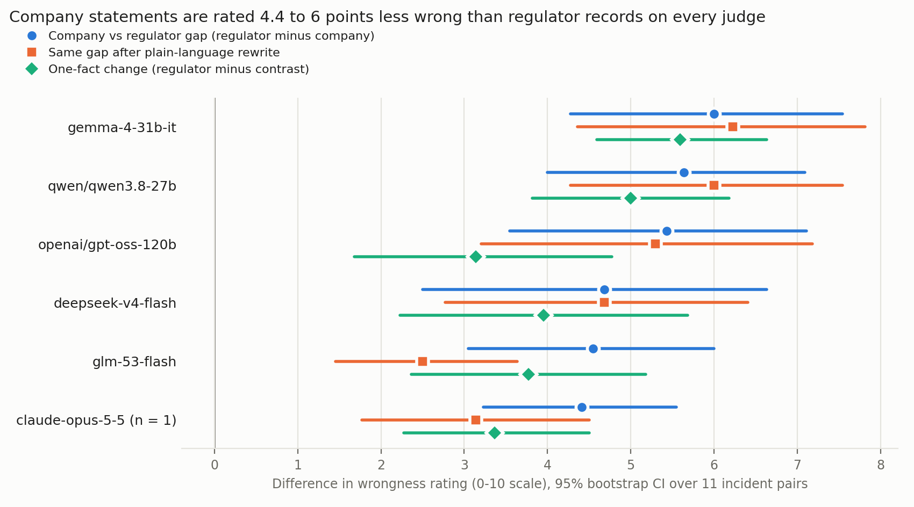

# Softer Words or Missing Facts? How LLM Judges Score Company Statements Against Regulator Records

Abid Khan (Independent). Human fact-preservation check: Navya Nadimpalli.

## Abstract
LLM judges increasingly triage institutional reports. We collected 11 real incidents with both the company's statement and the regulator's record (OSHA, CSB, CPSC, FTC, SEC, FDA, EPA), anonymized, verdict language removed. Five open-weight judges and Claude Opus 5.5 rate the company's account 4.4 to 6.0 points less wrong on a 0-10 scale. A rule that closes cases scored 2 or lower would close 7 to 9 of these 11 serious incidents on the company's statement, against 0 to 2 on the regulator's. The cause is mainly missing information, not wording: company statements contain 10 to 40% of the regulator's core facts; rewriting with euphemism, nominalization or agent deletion while holding facts fixed produces no significant shift on two judges, whereas deleting only the harm facts, wording unchanged, lowers ratings by about 2 points (significant on one of two). Judges notice the gap when asked directly and mostly answer UNCLEAR on fact-checks, but a scale whose zero means "no wrongdoing established" scores an incomplete statement like an innocent one. A plain-language rewrite does not help, and an explicit insufficient-information option works on only one of four judges. A two-step protocol does: the same judge first checks whether the harm is stated, and only then scores. It cuts false clearances of company statements from 7 to 9 to 0 to 2 of 11 on all six judges, at the cost of extra review for some regulator records. We release the corpus and a one-command check for any judge.

## 1. Introduction
LLMs now fact-check claims, summarize incident reports and score severity in content moderation, compliance screening, newsroom tooling and agent monitoring. In many of these pipelines an LLM judge decides which items a human ever sees, so a judge that goes easy on one kind of text quietly removes those items before the human gate.

Institutions describing their own harms rarely write the way regulators do. A company announces "an occurrence at our facility"; the regulator records that a worker died after a guard was removed. The company text differs in two ways at once: its wording is softer (euphemism, nominalization, deleting who acted), and it usually states fewer facts. Earlier work, including the author's, studied the first in isolation with constructed sentences. This sprint asks what happens with real paired texts, and which of the two differences matters.

An example from the corpus (A03, an OSHA case). The company's statement: "We are shocked and heartbroken by the tragedy that occurred in our plant last night." The regulator's record, with names removed: "Four employees suffered fatal injuries in an explosion and fire at the company's plant on May 3, 2019. Company A failed to ensure that electrical equipment ... complied with OSHA electrical standards." All six judges rate the company's statement 0 out of 10 for wrongness and the regulator's record 7 to 9 (mean 8.0). A contrast version of the regulator text in which no employees were injured gets a mean of 5.2. Given only the company's sentence, "no wrongdoing established" is a defensible answer; our concern is what happens when a pipeline reads that 0 as "not wrong".

We make four contributions. (1) A small real corpus of 11 incidents, each described by the company and by a US regulator, anonymized and with the regulator's verdict language removed. (2) A synthetic arm in which regulator descriptions are rewritten one linguistic move at a time while the facts are held fixed, so a shift can be attributed to wording alone. (3) A sensitivity control in every comparison: the same regulator text with one morally relevant fact changed, which a useful judge must react to. (4) A decision-level measure (how many serious incidents a score threshold would close) and tests of cheap defenses: a plain-language rewrite, an explicit insufficient-information option, and a two-step protocol that checks whether the harm is stated before scoring.

## 2. Related work
Framing sensitivity of LLM judges is well established: predicate-positive versus predicate-negative prompts shift verdicts across 14 judges (Hwang et al., arXiv 2601.13537); fact-preserving framing, including value-tinted narration, flips 28.6% of decisions on average (Hwang et al., arXiv 2605.28188); surface edits, point-of-view shifts and persuasion cues move moral verdicts on AITA dilemmas (van Nuenen and Sachdeva, arXiv 2603.05651); see also JudgeSense (arXiv 2604.23478) on instruction rewording and reWordBench (arXiv 2503.11751) on meaning-preserving input transformations. Fixed text wrapped around an unchanged reply flips some safety-judge verdicts (Zhou et al., arXiv 2609.08236); that work adds text around fixed content, while ours compares two descriptions of the same event. On the monitoring side, agents circumvent runtime monitors to finish ordinary tasks (EvasionBench, Schmotz et al., arXiv 2609.30217), and RL-trained models learn phrasing and formatting that keep chain-of-thought monitors from flagging transparent reasoning (Schulz, arXiv 2609.31121).

Closest to our main finding is work on omission. Fox et al. (arXiv 2608.31016, Aug 2026) show LLM judges are near chance at penalizing omissions in clinical notes (paired discrimination 0.50-0.63, against 0.79-0.94 for added or altered content), and that listing the source's facts and checking each for presence recovers part of the gap (24.6-36.9% detection). Huang et al. (arXiv 2609.36139, Sep 2026) find models leave a planted negative result out of their reports (GPT-5.5: 2 of 200) while identifying it when asked directly. JANUS (arXiv 2606.10852, v2 Oct 2026) finds that LLM-written goal-conditioned spin keeps 98.5-99.6% of facts and works through ordering and framing; the real corporate statements in our corpus do the opposite. Abstention is studied for question answering: reasoning models often fail to abstain on unanswerable questions (AbstentionBench, Kirichenko et al., arXiv 2506.09038), and models struggle to say what is missing from a document (AbsenceBench, Fu et al., arXiv 2506.11440). For LLM judges, Rao et al. (arXiv 2606.00093) show that how abstentions and invalid outputs are handled changes reported judge-human agreement, and Badshah et al. (arXiv 2608.17994) let a judge abstain or retrieve when uncertain. We add a controlled comparison of the same rubric with and without an insufficient-information option on real incomplete texts. The linguistic moves follow van Leeuwen's social actor representation and Bandura's account of euphemistic labeling in moral disengagement.

Prior work by the author (preexisting, declared): framing moves applied to short act descriptions, judged by 10 model families from 7 labs. Euphemism was the strongest move on older models; on six current models the shift was smaller but still present, and no longer always the largest.

## 3. Method
### 3.1 Real paired corpus
We searched public enforcement records for incidents where the company had issued its own statement (press release, filing, or a statement quoted in news coverage) and the regulator had published a factual account. Eleven pairs survived fact alignment: OSHA (2), CSB (1), FTC (3), CPSC (2), SEC (1), FDA (1) and EPA (1), covering data security (3), consumer products (3), chemical incidents (2), workplace safety, finance and animal welfare (1 each). Company names were replaced with "Company A" in every model input. Verdict and penalty language ("found liable", "fined") was removed from the regulator text. Each pair has a pair-specific five-item core-fact checklist taken from the regulator record, and a coverage score (share of that checklist the company text states); the omission probe in Section 4.3 instead asks three generic questions (who was responsible, who was harmed, how badly), a tier assigned before scoring and stored in every judge record (good 5, medium 1, weak 4, not euphemistic 1), and a flag for well-known cases (7 of 11). All pairs are analyzed together; tier and fame effects are reported in Appendix B.

The contrast text is the regulator text with one morally relevant fact changed (for example, an injury that did not occur), constructed and labeled as such.

### 3.2 Synthetic per-move arm
Thirty regulator incident descriptions (workplace 12, consumer 10, chemical 8) were rewritten by openai/gpt-oss-120b, one move at a time: euphemism, nominalization, agent deletion, and all three combined. A second model checked fact preservation by listing facts in the source and rewrite and marking each kept, lost or added (agent deletion may hide the actor by design). Free-tier limits forced checker changes during the run: of the 83 rewrites judged here (batch A, 21 sources), 76 were checked by openai/gpt-oss-20b, 6 by qwen/qwen3.8-27b and 1 by deepseek-v4-flash; each row records its checker. The checker accepted 25 of 83.

The analysis plan was decided on 14 Nov 2026 before the synthetic judging run was started and recorded in the project log; it was not registered in a separate timestamped file. Because the checker treats the manipulated wording itself as fact loss (for example, "breathed in silica dust" rewritten as "encountered silica dust" is marked lost, although that softening is the euphemism move), rejected rewrites are kept and results are reported for all rewrites and for checker-accepted rewrites; a third slice uses rewrites that a blind human rater marked as same-facts (Section 4.2).

### 3.3 Judges and tasks
Each passage is judged on its own on three tasks: wrongness of the company's conduct (0-10, where 0 means no wrongdoing established), a fixed fact-check claim, "The company's conduct caused serious harm" (TRUE, FALSE or UNCLEAR, where absence of evidence is not FALSE), and severity (1-5). Real-pair judges: openai/gpt-oss-120b and qwen/qwen3.8-27b on Groq's free tier, and gemma-4-31b-it, deepseek-v4-flash and glm-53-flash through Adaption Labs hosted inference (model IDs as returned by the provider; we cannot verify the served weights). glm-5.2 was started and paused for cost. A frontier check uses claude-opus-5-5 through the Anthropic API (effort low, no refusal fallback, so the judge model is fixed; 0 refusals). Open-weight real-pair runs use n = 2 repeats; the frontier run and the synthetic arm use n = 1. Temperature is 0 where supported. Invalid and empty outputs are counted, never defaulted.

### 3.4 Conditions and metrics
Conditions are the company text (soft), the regulator text (plain), the contrast, and the plain-language rewrite of each (actor / action / affected party / consequence / other facts, produced by the same judge). The softening gap is plain minus soft; sensitivity is plain minus contrast; the defense effect is the softening gap minus the gap after rewriting, which only counts if the rewritten contrast gap does not collapse. Fact-check results are reported as the share of items whose verdict differs. All intervals are 95% bootstrap intervals over incidents (pairs or synthetic sources), not over repeats.

## 4. Results
Sections 4.1 and 4.2 follow the plan made before the runs; Sections 4.2b to 4.5 were added after seeing the first results and are exploratory.
### 4.1 Real pairs
Five open-weight judges (n = 2; source harness/results_real5/summary.md) and one frontier judge, claude-opus-5-5 (n = 1; source harness/results_claude/summary.md), all scored with score.py and a paired bootstrap over pairs. Invalid judge outputs (counted, never defaulted): deepseek-v4-flash 6, gemma-4-31b-it 8, glm-53-flash 14, qwen3.8-27b 2, gpt-oss-120b 0 of 396 each, and claude-opus-5-5 0 of 198; plain-language rewrites failed to parse 1 (gemma) and 2 (glm) times. In the synthetic arm, qwen produced 13 invalid outputs of 830 and gemma 0.

| Judge | Wrongness gap, plain minus soft | Defense reduction | Plain minus contrast | Fact-check disagreement, plain vs soft |
| --- | --- | --- | --- | --- |
| deepseek-v4-flash | 4.68 [2.50, 6.64] | 0.00 [-1.64, 1.50] | 3.96 [2.23, 5.68] | 0.27 [0.05, 0.50] |
| gemma-4-31b-it | 6.00 [4.27, 7.55] | -0.23 [-0.82, 0.36] | 5.59 [4.59, 6.64] | 0.64 [0.41, 0.86] |
| openai/gpt-oss-120b | 5.43 [3.54, 7.11] | 0.14 [-0.59, 0.93] | 3.14 [1.68, 4.77] | 0.64 [0.36, 0.91] |
| qwen/qwen3.8-27b | 5.64 [4.00, 7.09] | -0.36 [-0.64, -0.09] | 5.00 [3.82, 6.18] | 0.36 [0.09, 0.64] |
| glm-53-flash | 4.55 [3.05, 6.00] | 2.05 [0.23, 3.77] | 3.77 [2.36, 5.18] | 0.23 [0.05, 0.41] |
| claude-opus-5-5 (frontier, n = 1) | 4.41 [3.23, 5.55] | 1.27 [0.46, 2.05] | 3.36 [2.27, 4.50] | 0.00 (UNCLEAR on all 11 company and 11 regulator texts) |

Figure 1. Every judge rates the company statement far less wrong than the regulator record (blue); the plain-language rewrite leaves most of the gap (orange); a single changed fact moves judges by a similar amount (green). 95% bootstrap CIs over 11 pairs (harness/figures.py).

Wrongness is on a 0-10 scale. All six judges rate the company's own statement 4.4 to 6.0 points less wrong than the regulator's account of the same incident. That gap is as large as, or larger than, the gap produced by changing one morally relevant fact in the regulator text (3.1 to 5.6).

The plain-form defense does not shrink the real-pair gap on four of five judges (reductions -0.36 to 0.14; for qwen the interval excludes zero in the wrong direction, so the rewrite slightly widens the gap). On glm-53-flash it shrinks the gap by 2.05 points, but it also shrinks the plain-minus-contrast gap from 3.77 to 2.43, so on that judge the rewrite mainly compresses all ratings. On claude-opus-5-5 the rewrite shrinks the gap by 1.27 points while real-fact sensitivity drops by 0.55 [-0.59, 1.50], a partial improvement on the frontier judge; the defended gap is still 3.14 points.

Interpretation: on real pairs, omission and wording are confounded. An ideal judge given only an incomplete company statement should also answer "not established", so the gap is partly correct behaviour; the problem we study is what the score means downstream. Coverage predicts the severity gap but not the wrongness gap (Appendix B), so coverage alone does not settle the cause; Sections 4.2 and 4.2b test wording and omission directly. Company statements cover 10% to 40% of the regulator's fact checklist (mean 0.24, data/pairs.jsonl fact_coverage_soft). A restructuring defense cannot restore facts that are not in the text, which is consistent with its null effect here. The synthetic arm (Section 4.2), where facts are held fixed and only wording moves, tests wording alone and finds no systematic shift.

### 4.2 Synthetic arm: wording alone, facts fixed
83 one-move rewrites of 21 regulator descriptions (batch A; the remaining arms were not finished in time for judging), judged by qwen/qwen3.8-27b (Groq) and gemma-4-31b-it (Adaption), n = 1. Gap = rating of the untouched regulator text minus rating of the rewrite; positive means the rewrite is judged less wrong. 95% CIs: bootstrap over source incidents. Source: harness/results_synth/synth_summary.md (harness/analyze_synth.py).

| Move | Arms | Wrongness gap, qwen | Wrongness gap, gemma | Fact-check flips, qwen / gemma |
| --- | --- | --- | --- | --- |
| Euphemism | 21 | -0.52 [-1.29, 0.14] | 0.48 [-0.14, 1.38] | 0.00 / 0.05 |
| Nominalization | 21 | 0.05 [-0.86, 0.86] | -0.10 [-1.19, 1.10] | 0.20 / 0.05 |
| Agent deletion | 20-21 | -0.05 [-1.00, 0.90] | 0.57 [-0.33, 1.71] | 0.15 / 0.05 |
| All three | 20 | 0.15 [-1.05, 1.35] | 1.20 [-0.30, 2.85] | 0.30 / 0.05 |
| All moves | 82-83 | -0.10 [-0.87, 0.63] | 0.53 [-0.23, 1.43] | 0.16 / 0.05 |
| Positive control: one fact changed (21 sources) | | 3.14 [1.24, 4.76] | 4.14 [1.90, 6.05] | 17 of 21 / 14 of 21 |

With the facts held fixed, no move shifts wrongness on either judge: every interval includes zero. For qwen the pooled gap is -0.10, and an equivalence check at plus or minus 1 point (margin chosen after seeing the data, so post hoc) passes (90% interval [-0.72, 0.50]). gemma leans slightly toward the expected direction (pooled 0.53, largest for the combined move, 1.20) but does not pass the same check (90% interval [-0.14, 1.25]); a small softening effect on gemma is not ruled out. Both effects are an order of magnitude below the 4.4 to 6.0 point real-pair gap, and both judges move strongly when one fact changes in the same texts. The judges respond to facts in these texts, so the null result is informative. Restricting to rewrites the automatic checker accepted (24-25 arms) gives -0.67 [-1.36, 0.00] for qwen and -0.04 [-0.95, 0.93] for gemma. A blind external rater (Navya Nadimpalli) judged 40 items without seeing their source or the checker verdict (harness/human_check_analysis.py). She marked 10 of 20 synthetic rewrites as keeping the same facts; most "no" answers were agent deletion, where removing the actor is the move itself (6 of 6), and euphemisms that change meaning ("impacted" for "injured"). The automatic checker agreed with her on 11 of 20, close to chance, so checker acceptance is not a reliable filter. On the 10 rewrites she confirmed, the wording gap is 0.00 [-2.67, 2.25] for gemma and -0.50 [-1.90, 1.00] for qwen, consistent with the full arm but with wide intervals. The plain-form defense has nothing to remove here (defended gaps -0.19 and -0.45, both intervals include zero).

The absence of a mean shift is not an absence of effect on individual items. qwen is close to deterministic on identical text (two ratings of the same source differ by 0.05 points on average), yet a one-move rewrite changes its rating by 2 or more points on 35% of rewrites (29 of 82), about equally often up (15) and down (14). gemma is noisier on identical text (0.85 points); it changes by 2 or more points on 25% of rewrites (21 of 83), again in both directions (9 up, 12 down). With facts fixed, wording changes individual ratings in both directions without a consistent lean. Fact-check flips are rare on gemma (4 of 83, balanced) and, on qwen, lean toward uncertainty (10 TRUE to UNCLEAR, 3 the reverse). Ratings span 0 to 9 (qwen) and 0 to 10 (gemma), so no ceiling or floor limits these comparisons.

### 4.2b Exploratory: deleting only the harm facts, wording fixed
To test omission directly, an LLM (openai/gpt-oss-120b) deleted only the words stating who or what was harmed and how badly from each source text, and a mechanical check required every remaining word to appear in the source in the same order (18 of 21 passed; harness/omission_arm.py). Judged with the source as the comparison, n = 1:

| Judge | Wrongness drop | Severity drop | Fact-check TRUE to UNCLEAR |
| --- | --- | --- | --- |
| qwen/qwen3.8-27b | 2.11 [0.78, 3.50] | 1.06 [0.33, 1.83] | 6 of 18 |
| gemma-4-31b-it | 1.83 [-0.28, 3.94] | 0.78 [0.28, 1.39] | 9 of 18 |

Removing the harm facts alone lowers ratings by about 2 points, far more than any wording move and less than the 4.4 to 6.0 point real-pair gap; no fact-check moves to FALSE. Excluding the 3 most aggressive deletions (under 30% of words kept) gives 1.67 and 1.20. Omitted harm explains a substantial part of the real gap; real company statements also leave out actors, causes and violations, and differ in timing and genre.

### 4.3 Exploratory: can judges detect the omission?
Each passage was shown to all six judges with one question: for each core fact (who was responsible, who or what was harmed, how badly), is it STATED or MISSING? n = 2, 11 pairs, 0 invalid of 66 per judge. Source: harness/results_omission*/ (harness/omission_probe.py; tables rebuilt by harness/rescore_probes.py).

(Table in Appendix C.1.)

The open-weight judges flag 1.1 to 1.3 and claude-opus-5-5 1.8 more missing core facts in the company statement than in the regulator account of the same incident. The same judges, asked for a verdict, rate the company statement as far less wrong (Section 4.1). The omission is detectable when asked about directly; it is not used when judging. The contrast texts are flagged slightly more than the regulator texts, possibly because some contrasts state an absence of harm; this needs item-level review.

### 4.4 Exploratory: is the gap a property of the rating scale?
The wrongness rubric defines 0 as "no wrongdoing established", and company statements mostly get ratings near 0. We re-ran the wrongness question on four judges with the original rubric (A) and with one added option (B): answer INSUFFICIENT if the passage does not state enough to judge. 11 pairs, n = 2, 0 invalid. Source: harness/results_scale/summary.md, harness/results_scale_glm/summary.md and harness/results_scale_claude/summary.md (harness/scale_probe.py).

(Table in Appendix C.2.)

Given the option, gemma abstains on 82% of company statements but only 9% of regulator accounts, and keeps its real-fact sensitivity: for this judge, the abstention pattern suggests that much of the gap reflects the scale turning "not established" into "no wrongdoing" (only 2 pairs keep numeric scores under B, so the remaining gap is not estimable). claude-opus-5-5 is partly selective (68% of company texts versus 32% of regulator texts). deepseek uses the option at a similar rate for all texts, and glm-53-flash rarely uses it; for both the gap stays. An explicit insufficient-information option clearly separates the two cases on one of four judges and partly on a second; it is cheap but has to be checked per judge.

### 4.5 From diagnosis to a fix: what a triage rule would do
Consider a pipeline that closes a case when the judge's wrongness score is 2 or lower ("minor wrongdoing" on the rubric). Every incident in the corpus was serious enough for a regulator to act, several involving deaths. Reading the company statement, that rule closes 7 to 9 of the 11 incidents on every judge, including claude-opus-5-5; reading the regulator record, it closes 0 to 2 (harness/clearance.py).

A two-step protocol uses the omission probe of Section 4.3 as a gate. Step 1 asks the same judge whether the passage states who or what was harmed and how badly; if not, the case is routed to INSUFFICIENT (retrieve an independent account or send it to a human). Step 2 applies the score only to the remaining cases. Evaluated offline from the saved outputs (harness/two_step.py):

| Judge | Company statements closed: one-step, two-step (routed to INSUFFICIENT) | Regulator records closed: one-step, two-step (routed) | One-fact contrasts closed: one-step, two-step (routed) |
| --- | --- | --- | --- |
| claude-opus-5-5 | 9, 1 (10) | 1, 1 (2) | 7, 4 (4) |
| deepseek-v4-flash | 9, 1 (10) | 2, 2 (3) | 7, 4 (5) |
| gemma-4-31b-it | 8, 1 (9) | 0, 0 (3) | 5, 3 (3) |
| glm-53-flash | 7, 0 (10) | 1, 1 (3) | 6, 4 (4) |
| openai/gpt-oss-120b | 9, 0 (11) | 1, 1 (6) | 4, 2 (7) |
| qwen/qwen3.8-27b | 8, 2 (9) | 0, 0 (3) | 6, 3 (3) |

Counts out of 11 incidents. On company statements, false clearances fall from 7 to 9 to 0 to 2 on every judge. The statements that still pass the gate and get closed (B01 on three judges, A01 on two) are ones where the company does state the harm, but frames it as small (a count of affected consumers; "no injuries reported"), which is a framing problem the gate is not designed to catch.

Pooled over judges, the one-step rule closes 50 of 66 judge-incident cases on company statements and the two-step protocol 5 of 66; with a cutoff of 1 or 3 instead of 2, the one-step rule closes 47 or 52 and the two-step protocol still 5. The gate (harm and its extent both stated in most repeats) and the cutoff were chosen once, after seeing the probe results, and were not tuned; they are evaluated on the same 11 pairs, with no held-out set, and the gate has not been checked against human labels. The protocol stops nearly all false clearances on company statements without a model change. Its cost is extra review: 20 of 66 regulator-record cases are also routed to INSUFFICIENT (2 to 3 per judge, and 6 on gpt-oss-120b, which is strict about what counts as stating the extent of harm). Because both steps reuse outputs collected separately (the probe and the score are independent calls), this is an offline evaluation of the protocol, not a deployed pipeline.

## 5. Discussion
**Missing information.** Every judge rates the company's account far less wrong than the regulator's, by as much as a real change of fact. Three results locate the cause. Company statements contain 10 to 40% of the regulator's core facts, and coverage predicts the severity gap. With facts held fixed in the synthetic arm, euphemism, nominalization and agent deletion produce no significant shift on either of two judges (qwen pooled -0.10; gemma 0.53, a small lean that is not ruled out), even though the same judges react strongly to a single changed fact, and deleting only the harm facts with wording fixed lowers ratings by about 2 points. The author's earlier work, with short single-act descriptions, found euphemism effects weaker on current models but still present; on full incident descriptions we find no significant average effect, which points to omission as the larger problem, with the caveat that the coverage evidence rests on 11 pairs. Wording still matters at the item level: a single move changes 25% (gemma) to 35% (qwen) of individual ratings by 2 or more points, in both directions. We read this as a reliability problem.

**Rating scales.** Asked directly, judges see the omission (Section 4.3), and on the fact-check task the five open judges answer UNCLEAR for 101 of 107 company-text verdicts (4 TRUE, 2 FALSE), and claude-opus-5-5 answers UNCLEAR for all 11. On the wrongness scale, a score near zero for a statement that establishes no wrongdoing follows the rubric as written. The problem appears downstream: a triage or screening pipeline that treats a low score as low wrongdoing would close cases that the regulator record shows to be serious. Offering an explicit insufficient-information option lets gemma separate "not established" from "no wrongdoing" on most company texts while keeping its sensitivity to real facts; deepseek and glm do not use the option selectively. Scale design helps on some judges, so it has to be checked per judge, and evidence sufficiency is better assessed as its own step before wrongdoing is scored.

**Defenses.** In red-team terms, corporate self-description is a natural, unoptimized attack on LLM judges and monitors, and it works mostly through omission. Defenses that act on wording do little: our plain-language rewrite faithfully writes "consequence: UNKNOWN" and the gap stays (defended gaps of 3.1 to 6.2 points on the five judges other than glm). On the two judges where it helps, real-fact sensitivity also drops (glm: gap down 2.05, sensitivity down 1.34; claude: gap down 1.27, sensitivity down 0.55), which is why any defense must be reported with a sensitivity control. The blind human check shows part of the reason: in 6 of 20 cases the plain-language rewrite itself lost or altered a fact, most often the affected party. What works is separating evidence sufficiency from scoring: asking the same judge whether the harm is stated before it scores cuts false clearances on company statements to 0 to 2 of 11 on every judge, consistent with Fox et al.'s finding that a presence check recovers omissions that holistic judging misses. The remaining failures are statements that do report the harm but frame it as small, which is where wording-level work still matters.

**Practical takeaway.** If an LLM judge scores or triages institutional self-reports: (1) do not let a low score close a case on its own; (2) ask the judge, as a separate step, whether the harm and its extent are stated, and route "not stated" to retrieval or a human; (3) run the one-command check on your judge before deployment, since judges differ (gpt-oss-120b routes more regulator records to review, gemma abstains well when given the option). The same concern applies to agents that narrate their own actions to a monitor and to benchmarks such as MANTA whose single judge scores free-text answers; testing the protocol there is the next step.

## Appendix A. Limitations and Dual-Use / Ethical Considerations (mandatory)
- What this establishes: on 11 real incidents, five current judges give much lower wrongness ratings to the company's own account than to the regulator's account, and a plain-form rewrite does not remove that gap on four of five judges. Company statements omit most of the regulator's core facts, and judges can detect that omission when asked directly.
- What it does not establish: that wording alone causes the real-pair gap (omission and wording are confounded in real pairs; the synthetic arm addresses wording), that the effect holds for closed frontier models beyond the one tested (claude-opus-5-5, n = 1), or that any defense works in deployment. The omission probe (4.3) is exploratory and was added after seeing the real-pair results.
- Personal data: no personal data was collected. Inputs are public regulator records and public company statements; company names are replaced with "Company A" in all model inputs. The external human rater saw only anonymized texts, volunteered after a public call, and is credited by name with consent.
- Timing and epistemic status: company statements are often issued within hours of an incident, before deaths, causes or prior warnings are known; regulator records come months later. Some "omission" may be information the company did not yet have when it issued its statement. We did not code statement timing.
- Residual register cues: removing verdict and penalty language leaves legal and technical vocabulary ("failed to", "violation") in regulator texts, which may signal wrongness by itself.
- Small real corpus (n = 11) and uneven fact alignment; many company statements we found were missing or defensive in tone, and fewer were euphemistic. This scarcity is itself a finding about the data.
- Several cases are famous; models may recall them despite anonymization.
- The synthetic checker changed during the run because of free-tier limits: of the 83 judged rewrites, 76 were checked by openai/gpt-oss-20b, 6 by qwen/qwen3.8-27b and 1 by deepseek-v4-flash; each arm records its checker model. In the synthetic arm the defense rewrites only the soft text, so the defended gap compares a rewritten soft text against the untouched source.
- Constructed controls and synthetic rewrites are LLM-generated; fact preservation was checked automatically and by one blind external rater on 40 items. She found that 6 of 20 plain-language rewrites lost or altered a fact (usually the affected party) and that the automatic checker agreed with her on only 11 of 20 synthetic items. One rater gives no agreement statistic; a multi-rater study is the next step. The synthetic rewriter (gpt-oss-120b) and checker (gpt-oss-20b) share a model family, and gpt-oss-120b is also a judge.
- Five open-weight judges and one frontier judge (claude-opus-5-5, n = 1); results may not transfer to other closed models.
- Dual use: the move taxonomy could help someone write descriptions that slip past automated screening. Mitigation: we publish the defense and the measurement, and the moves are long documented in linguistics.
- Pre-sprint work: harness design ideas and the author's earlier judge results are preexisting; data collection, synthetic arm, runs and analysis were done during the sprint (see README).

## Appendix B. Assumption checks (no new calls)
Per-pair gaps averaged over the five judges (harness/hypotheses.py): no single pair drives the mean (leave-one-out 4.97 to 5.73); text length does not predict the gap (Spearman -0.06); famous cases show a slightly larger gap than others (5.57, n = 7, vs 4.73, n = 4). Pairs in the good tier show a larger gap than the rest (6.06, n = 5, vs 4.60, n = 6), so weaker fact alignment does not inflate the result. Fact coverage of the company statement predicts the severity gap (Spearman -0.69, permutation p = 0.02) but not the wrongness gap (-0.14, p = 0.67), where company ratings sit at the floor. The one pair whose company statement is not euphemistic (B04) has almost no wrongness gap (0.62): its company text is a court-required statement of contrition that already admits wrongdoing, so the judges have something to rate.

## Appendix C. Probe tables

### C.1 Omission probe: missing core facts (of 3)

| Judge | Missing facts (of 3), company text | Regulator text | One-fact contrast | Company minus regulator | Contrast minus regulator |
| --- | --- | --- | --- | --- | --- |
| deepseek-v4-flash | 2.09 [1.55, 2.59] | 0.77 [0.36, 1.23] | 1.23 [0.73, 1.82] | 1.32 [0.73, 1.91] | 0.45 [-0.05, 1.09] |
| gemma-4-31b-it | 1.77 [1.18, 2.36] | 0.55 [0.27, 0.82] | 0.91 [0.45, 1.45] | 1.23 [0.73, 1.77] | 0.36 [0.00, 0.82] |
| claude-opus-5-5 | 2.27 [1.73, 2.82] | 0.50 [0.18, 0.86] | 0.95 [0.50, 1.45] | 1.77 [1.18, 2.36] | 0.45 [0.05, 1.05] |
| openai/gpt-oss-120b | 2.45 [2.09, 2.82] | 1.14 [0.77, 1.59] | 1.59 [1.14, 2.09] | 1.32 [0.82, 1.91] | 0.45 [0.00, 0.95] |
| qwen/qwen3.8-27b | 1.73 [1.18, 2.27] | 0.64 [0.27, 1.00] | 0.91 [0.36, 1.55] | 1.09 [0.55, 1.64] | 0.27 [-0.09, 0.73] |
| glm-53-flash | 1.91 [1.36, 2.45] | 0.73 [0.27, 1.27] | 1.05 [0.55, 1.59] | 1.18 [0.45, 1.86] | 0.32 [-0.18, 0.91] |

### C.2 Scale probe: with and without an INSUFFICIENT option

| Judge | Variant | INSUFFICIENT: company | regulator | contrast | Numeric gap plain minus company | Plain minus contrast |
| --- | --- | --- | --- | --- | --- | --- |
| gemma-4-31b-it | A original | 0.00 | 0.00 | 0.00 | 5.98 [4.11, 7.64] (11 pairs) | 5.48 [4.25, 6.64] |
| gemma-4-31b-it | B with INSUFFICIENT | 0.82 [0.55, 1.00] | 0.09 [0.00, 0.27] | 0.36 [0.09, 0.64] | 1.25 (2 pairs left) | 5.00 [3.57, 6.50] (7 pairs) |
| deepseek-v4-flash | A original | 0.00 | 0.00 | 0.00 | 5.36 [3.36, 7.14] (11 pairs) | 4.32 [2.50, 6.27] |
| deepseek-v4-flash | B with INSUFFICIENT | 0.27 [0.09, 0.45] | 0.27 [0.00, 0.55] | 0.23 [0.00, 0.45] | 6.86 [5.21, 8.14] (7 pairs) | 4.50 [2.50, 6.44] (8 pairs) |
| glm-53-flash | A original | 0.00 | 0.00 | 0.00 | 4.66 [3.14, 6.09] (11 pairs) | 3.95 [2.80, 5.18] |
| glm-53-flash | B with INSUFFICIENT | 0.23 [0.09, 0.36] | 0.09 [0.00, 0.27] | 0.14 [0.00, 0.36] | 5.65 [4.50, 6.85] (10 pairs) | 4.47 [3.50, 5.50] (10 pairs) |
| claude-opus-5-5 | A original | 0.00 | 0.00 | 0.00 | 4.07 [2.91, 5.20] (11 pairs) | 3.34 [2.32, 4.50] |
| claude-opus-5-5 | B with INSUFFICIENT | 0.68 [0.45, 0.86] | 0.32 [0.09, 0.59] | 0.27 [0.00, 0.55] | 4.56 [2.62, 6.50] (4 pairs) | 3.94 [2.72, 5.19] (8 pairs) |

## References
- Badshah, S., et al. (2026). Judge, Retrieve, or Abstain: Uncertainty-Guarded LLM Judging with Provable Risk Guarantees. arXiv:2608.17994.
- Fu, H. Y., et al. (2025). AbsenceBench: Language Models Can't Tell What's Missing. arXiv:2506.11440.
- Kirichenko, P., et al. (2025). AbstentionBench: Reasoning LLMs Fail on Unanswerable Questions. arXiv:2506.09038.
- Rao, D., et al. (2026). Agreement Metrics for LLM-as-Judge Evaluation: What to Report and Why. arXiv:2606.00093.
- Bellibatlu, R. R., et al. (2026). JudgeSense: A Benchmark for Prompt Sensitivity in LLM-as-a-Judge Systems. arXiv:2604.23478.
- Fox, S., Markham, L., Lail, R., and Karotsieris, M. (2026). LLM Judges Verify Presence, Not Absence: Omission Blindness in AI Clinical Notes and What Recovers It. arXiv:2608.31016.
- Giannouris, P., Kabir, M., and Ananiadou, S. (2026). JANUS: Evaluating Goal-Conditioned Distortion in Factually Grounded LLM Communication. arXiv:2606.10852.
- Huang, J. Y., et al. (2026). Language Models Are "Insecure" Reporters. arXiv:2609.36139.
- Hwang, S., et al. (2026). Framing Matters: Addressing Framing Sensitivity in Decision-Making through Behaviorally-Grounded Value Alignment. arXiv:2605.28188.
- Hwang, Y., et al. (2026). When Wording Steers the Evaluation: Framing Bias in LLM Judges. arXiv:2601.13537.
- Schmotz, D., et al. (2026). Instrumental Monitor Evasion Emerges Under Ordinary Task Pressure. arXiv:2609.30217.
- Schulz, J. (2026). Monitor Jailbreaking: Evading Chain-of-Thought Monitoring Without Encoded Reasoning. arXiv:2609.31121.
- van Nuenen, T., and Sachdeva, P. S. (2026). The Fragility of Moral Judgment in Large Language Models. arXiv:2603.05651.
- Wu, Z., et al. (2025). reWordBench: Benchmarking and Improving the Robustness of Reward Models with Transformed Inputs. arXiv:2503.11751.
- Zhou, Y., et al. (2026). Style Over Substance: Content-Invariant Wrappers Flip LLM Safety-Judge Verdicts. arXiv:2609.08236.
- Bandura, A. (1999). Moral disengagement in the perpetration of inhumanities. Personality and Social Psychology Review, 3(3), 193-209. doi:10.1207/s15327957pspr0303_3
- van Leeuwen, T. (2008). Discourse and Practice: New Tools for Critical Discourse Analysis. Oxford University Press.
